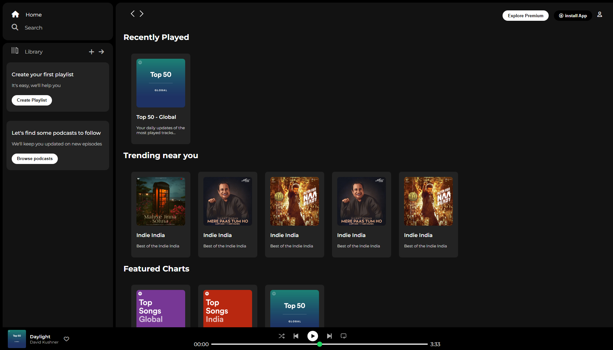

# Spotify Clone (HTML & CSS)

A static front-end clone of the Spotify web player, built to practice HTML and CSS layout.

> Educational project. Not affiliated with or endorsed by Spotify. Logos and album covers belong to their respective owners.

## Live Demo
https://thecodeyss.github.io/spotify-clone/

## Screenshot


## What I practiced
- Page layout with **Flexbox** (sidebar, scrolling main area, fixed bottom player)
- **Sticky** top navigation bar and **fixed** music player
- Card grid using `flex-wrap`
- Custom-styled range slider for the progress bar
- Responsive behaviour with a `@media` query
- Icons from Font Awesome and fonts from Google Fonts

## Project structure
```
spotify-clone/
├── index.html      # page structure
├── style.css       # all styling (commented section by section)
├── Asset/          # images and icons
└── README.md
```

## Run locally
Download or clone the repo and open `index.html` in your browser. No installation needed.

## Status and next steps
- [x] Layout: sidebar, main content, music player
- [ ] Make the page fully responsive for mobile
- [ ] Add JavaScript: play/pause, progress bar, like button
- [ ] Add volume controls
